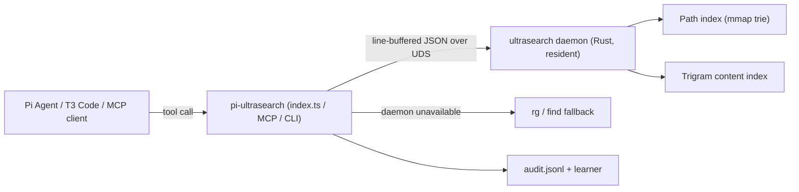

# pi-ultrasearch

> Whole-disk filesystem search, trigram content grep, and git-aware code discovery for **Pi Agent**, **T3 Code**, and MCP clients — backed by a persistent resident Rust daemon (`ultrasearch`).

[](CHANGELOG.md)
[](LICENSE)
[](https://github.com/Ghost-9/pi-ultrasearch/actions/workflows/ci.yml)
[]()

> **Honesty note.** Earlier versions of this README quoted best-case warm-cache micro-benchmarks as if they were
> session-level numbers, and claimed a green CI that never existed. Every figure below is now labelled with its
> measurement scope, and the full audit (`AUDIT-2026-10-14.md`) lists what was inflated and what changed.
> Live performance, limits and open gaps are documented rather than omitted.

---

## Versions

Two artifacts version independently, and that is deliberate:

| Artifact | Where | Current |
|---|---|---|
| **Engine + app** | `engine/Cargo.toml` — the daemon, the CLI and the MCP server | `0.2.1` |
| **Pi extension** | `package.json` — the native tool surface Pi loads | `0.3.1` |

`install.sh` reads the engine version from `Cargo.toml` and writes it into both
`CFBundleShortVersionString` and `CFBundleVersion`, so the app bundle, the crate
and the MCP `serverInfo` always agree. The extension is a separate npm package
with its own release line; `init --list` reports it as `extension` rather than
`no`, because Pi takes the tools natively instead of through an MCP entry.

## What it is

Agents lose time and context to `find`, `rg`, and `grep -rn` subprocesses. `pi-ultrasearch` keeps a resident index
of the filesystem (paths + trigram content) and answers those questions over a UNIX socket in **0.03–0.5 ms** while
staying inside the workspace boundary.

It ships as:

- a **Pi Agent extension** (6 tools + metrics tool + `/ultrasearch` commands),
- a **standalone CLI** (`ultrasearch query|grep|metrics|tui|compact`),
- a **stdio MCP server** for Antigravity, VS Code, Claude Desktop, and any MCP client,
- **QuickJS Code Mode** compatible tools (the Pi harness exposes registered tools to the sandbox).

### Naming and sockets

Everything user-facing is UltraSearch-only: the tools are `ultrasearch_query`, `ultrasearch_grep`,
`ultrasearch_multi_grep`, `ultrasearch_locate`, `ultrasearch_recent`, `ultrasearch_metrics`; the slash command is
`/ultrasearch`; the CLI is `ultrasearch` / `ultrasearch-tui` / `ultrasearch-mcp`. No `fsearch_*` alias is registered
on any surface. Remaining `fsearch` references are upstream attribution, legacy socket compatibility, or historical
audit records; the upstream MIT notice is preserved in `NOTICE`.

| Platform | Default daemon socket |
|:---|:---|
| macOS | `~/Library/Application Support/UltraSearch/ultrasearch.sock` |
| Linux | `$XDG_RUNTIME_DIR/ultrasearch.sock`, else `~/.local/share/ultrasearch/ultrasearch.sock` |
| Windows | `\\.\pipe\ultrasearch` |

Client and harness settings use the `PI_ULTRASEARCH_*` prefix. The Rust daemon also accepts `ULTRASEARCH_*`
variables for its index, scan root and content policy (see [`engine/BUILD.md`](engine/BUILD.md)).

---

## Measured performance (live, 2026-10-14, Apple Silicon)

### Warm socket micro-benchmarks (resident daemon, repeated calls)

| Operation | p50 | p95 | Notes |
|:---|:---:|:---:|:---|
| IPC ping | 0.031 ms | 0.112 ms | pure round-trip, 100 calls |
| Path search — small repo | 0.365 ms | 1.106 ms | 50 calls |
| Path search — Swift app repo | 0.475 ms | 1.141 ms | 20 calls |
| Trigram grep — small repo | 0.153 ms | 0.297 ms | 20 calls |
| Trigram grep — trigram-heavy scope | 0.480 ms | 0.784 ms | 50 calls |
| Multi-pattern grep | 1.842 ms | 5.886 ms | 10 calls, small scope |
| `git:modified` filter | 0.837 ms | 6.033 ms | 10 calls, clean tree |

Baseline comparison on the same scope (medians): **`find -name` 21.4 ms (45× slower)**, **`rg -l` 11.9 ms (78× slower)**,
`find` in a small repo 34.7 ms (95× slower).

### Real agent-session telemetry (production audit log, 38 organic calls)

| Tool | Calls | p50 | p95 | Max | Notes |
|:---|:---:|:---:|:---:|:---:|:---|
| `ultrasearch_query` | 13 | **41 ms** | **1,952 ms** | 4,007 ms | cold/global queries are the tail |
| `ultrasearch_grep` | 16 | 13.4 ms | 26.9 ms | 26.9 ms | |
| `ultrasearch_multi_grep` | 5 | 47.0 ms | 63.3 ms | 63.3 ms | |
| native fallback | 11/38 (29%) | — | — | — | daemon not used; being reduced |

**Read both tables together.** The warm path is genuinely sub-millisecond; a cold or whole-disk query can take
seconds. Tail latency and fallback rate are tracked as open work items (see `OPTIMIZATIONS.md`).

Planned performance work (tail latency, content coverage, concurrency, token accounting) is listed in
[`OPTIMIZATIONS.md`](OPTIMIZATIONS.md). The audit that produced these numbers is in [`AUDIT-2026-10-14.md`](AUDIT-2026-10-14.md).

---

## Tool surface

### 1. `ultrasearch_query`
Indexed file and path discovery, scoped to the active worktree (nearest `.git`), with an optional `global: true`.
- Strict zero typo tolerance: misspellings return 0 results (verified).
- Globs and filters: `src/**/*.{ts,tsx}`, `ext:rs`, `git:modified`, `git:staged`, `git:untracked`.
- Proximity re-ranking with `near:` or the `near` parameter.
- Respects declared `.gitignore` / `.ignore` rules in the scope root (outside git repos too).

### 2. `ultrasearch_grep`
Indexed trigram content search with four modes:
- `literal` (default), `regex`, `symbol` (AST declaration tags/priority), `semantic` (**experimental — see below**).
- `semantic` is intent keyword expansion, not a vector or embedding search. Measured on the
  project's own gold fixtures it is **not ready to rely on**: semantic nDCG@10 **0.194**,
  semantic-paraphrase recall@10 **0.175**, success@3 **0.10**, and **false-positive rate 1.00** on
  the paraphrase lane. It returns ten files for queries with no matching subject. Use `literal`
  or `symbol`; use `semantic` only to explore, never to gate a decision. Tracked as a known
  measurement, not a capability.
- Optional `context` lines (0–5) and `tag_symbols` for `[def:fn]`-style annotations.
- Enterprise DLP scrubbing before anything reaches the prompt.
- Content index covers the daemon's tracked text corpus — see *Known limits* below.

### 3. `ultrasearch_multi_grep`
Multi-pattern OR retrieval in one call with per-file match merging.

### 4. `ultrasearch_locate`
Exact filename resolution (`package.json`, `Cargo.toml`, …) with deduplication.

### 5. `ultrasearch_recent`
Frecency-ranked recent files, updated through the Pi `tool_execution_end` lifecycle hook.

### 6. `ultrasearch_metrics`
Latency percentiles, fallback rate, zero-hit diagnostics, CLI-bypass detector, and honest "tokens saved"
(is an estimate — see below).

---

## Observability

- **Audit log**: `~/.pi/agent/cache/pi-ultrasearch/audit.jsonl` — written by a **single layer** (the client),
  with test/benchmark runs isolated via `PI_ULTRASEARCH_TEST=1`. The regression gate no longer pollutes production data.
- **CLI-bypass detector**: flags `find`/`rg` subprocesses that could have used the index and feeds the recursive learner.
- **Recursive learner**: `recordMistake()` is now invoked by real failure paths (empty results, path mismatches,
  DLP interceptions, CLI bypasses), not just tests.
- **"Tokens saved" is an estimate**, computed as `150 + 75 × hits` for grep and `100 + 30 × hits` for path searches.
  It is not a prompt-token measurement; an A/B token-accounting harness is on the roadmap.

---

## MCP server

`bin/mcp-server.ts` speaks JSON-RPC 2.0 over stdio and exposes exactly one tool surface: the six
`ultrasearch_*` tools. The historical `fsearch_*` aliases are gone, so `tools/list` is the single
source of truth for every client. Protocol conformance (initialize/initialized, tools/list, tools/call,
notification semantics, unknown method, parse error, JSON-RPC error codes, stdio framing) is covered by
`test/mcp.test.ts` and runs hermetically without a daemon.

Registration is not hand-editing: `ultrasearch init` detects the harnesses on the machine and patches
their config with a timestamped backup, a printed diff and the exact revert command. It plans by
default and writes only with `--write`:

```bash
ultrasearch init --list                        # registry + what is detected/registered here
ultrasearch init --harness cursor              # show the diff, write nothing
ultrasearch init --harness cursor --write      # patch, with a backup and revert command
ultrasearch init --harness codex --remove --write
```

| Harness | Surface | Config |
|:---|:---|:---|
| Pi Agent | **native extension** (init skips it by default) | `~/.pi/agent/mcp.json` |
| T3 Code | inherits the Pi provider; CLI otherwise | — |
| Codex CLI | MCP | `~/.codex/config.toml` `[mcp_servers]` |
| Claude Code | MCP | `~/.claude.json` `mcpServers` |
| Claude Desktop | MCP | `claude_desktop_config.json` |
| Cursor | MCP | `~/.cursor/mcp.json` |
| Windsurf | MCP | `~/.codeium/windsurf/mcp_config.json` |
| Zed | MCP | `~/.config/zed/settings.json` `context_servers` (JSONC preserved) |
| VS Code | MCP | user `mcp.json` `servers` |
| Antigravity | MCP | `~/.gemini/antigravity/mcp_config.json` |

Each row carries a smoke artifact under `bench/harness-smoke/` (initialize + `tools/list` + one
`tools/call`, plus a native harness CLI arm where one exists) and the generated
[`docs/harness-matrix.md`](docs/harness-matrix.md) states exactly which arms ran and which are
explicitly `skipped:<reason>`. `npm run smoke:harness && npm run matrix:harness` regenerates both;
CI runs the smokes and fails on a missing or dishonest row.

Example MCP config entry:

```json
{
  "mcpServers": {
    "ultrasearch": {
      "command": "node",
      "args": ["/Users/your-name/.pi/agent/extensions/pi-ultrasearch/dist/bin/mcp-server.js"]
    }
  }
}
```

`npm run build` emits that entrypoint (see *Build & distribution*); `bin/mcp-server.ts` also works directly on
Node.js ≥ 22.18 through native TypeScript type-stripping. `ultrasearch init` resolves the command itself:
`--command`, `ULTRASEARCH_MCP_COMMAND`, `~/.local/bin/ultrasearch-mcp`, then `PATH`.

---

## Drop-in `us-rg` (ripgrep stays the fallback)

`scripts/us-rg` is a conservative ripgrep front-end. It accelerates exactly one case — a plain
literal content search over a directory or one named file — and sends **everything else** to the
real ripgrep unchanged: `--files`, `-l`, `-c`, `--json`, globs, types, context, regex, PCRE2. It
never shadows `rg`; install it under its own name:

```bash
ln -sf "$PWD/scripts/us-rg" ~/.local/bin/us-rg
us-rg "needle" src/                 # accelerated, ripgrep-compatible output
us-rg "needle" package-lock.json    # reads the named file even if the index skipped its text
us-rg --files src/                  # real ripgrep (correct semantics, still fast)
us-rg "a.*b" src/                   # regex → real ripgrep
```

Exit status follows ripgrep (`0` matches, `1` none, `2` fallback/error). Ripgrep must be installed;
`ULTRASEARCH_RG` overrides the binary path. A failed socket falls back to ripgrep, never to a silent
empty result.

## Interop & ergonomics (v0.5.0)

### Watch mode (#27)

```bash
ultrasearch watch "<query>" --in <dir> [--limit n] [--debounce ms] [--duration ms] [--once] [--json]
```

Streams the baseline matches, then one `add`/`remove` event per file as the directory changes. The watch loop does
not duplicate the daemon's journal: `fs.watch` supplies the change signal, `status` is consulted first so an event is
not answered while the index is behind, and the query itself reuses the normal socket path. A **silence watchdog**
polls the query when `fs.watch` has delivered nothing for `watchSilenceMs` (default 750 ms, period
`pollIntervalMs` 1000 ms), so a late or dropped FSEvents notification degrades to polling instead of silence; a
healthy watcher keeps the watchdog idle. `stop()` (or Ctrl-C) closes the watcher, removes signal handlers, stops
the watchdog and closes the client, so no socket or inode is held after exit. `--once` prints the baseline and exits
(used by the tests and by scripting). Events carry `via: "watch" | "poll" | "baseline"` so the detection path is
visible; `stats.pollRefreshes` counts fallback refreshes. The freshness probe is injectable
(`freshnessCheck`, or `null` to skip) for tests and callers that do not want the extra round trip.

### Multi-root workspaces and worktree dedupe (#28)

Extra roots are searched alongside the active worktree and merged by **realpath**: the same file is returned once,
and the copy under the active worktree wins. Hits from another root are attributed with `[root: <path>]` in CLI and
MCP output, and the number of collapsed duplicates is reported instead of silently dropped.

```bash
export ULTRASEARCH_ROOTS="/path/to/monorepo:/path/to/sibling-worktree"   # OS path delimiter
export ULTRASEARCH_ROOTS_FILE=~/.config/ultrasearch/roots.json            # default when the env var is unset
```

`~/.config/ultrasearch/roots.json`:

```json
{ "roots": ["/path/to/monorepo", "/path/to/sibling-worktree"], "preferActiveWorktree": true }
```

With no configuration the module is inert: one root, one daemon round trip. A root that resolves (by realpath) to
the active worktree is collapsed before any search. This is applied on the CLI and MCP surfaces; the Pi extension
keeps resolving the active worktree alone, as before.

### Code Mode declarations and recipes (#29)

`src/tool-schema.ts` is the single source of truth for the tool surface. `src/codemode.ts` generates the
`declare namespace tools` block from it, and `MCP_TOOLS` is derived from the same entries, so a parameter added in one
place cannot go missing in the other. `npm run codemode:declarations` regenerates the golden file at
`test/fixtures/codemode-declarations.txt`; `test/interop-surface.test.ts` fails the build when the generated text or
the Pi tool parameters drift. Shipped recipes (`search -> grep -> read`, symbol-then-context) run through
`runSearchGrepReadRecipe` and are executed end-to-end by the same test.

### MCP surface configuration (#30)

The default surface is exactly six `ultrasearch_*` tools. An operator can expose the same six definitions under an
extra prefix for a client configured before the rename, without hand-maintaining a second schema:

```bash
ultrasearch-mcp --alias ultra            # adds ultra_query ... ultra_metrics (12 tools on tools/list)
ultrasearch-mcp --prefix us              # renames the canonical prefix (6 tools)
ULTRASEARCH_MCP_ALIASES=a,b              # env equivalent (the canonical six always stay)
```

`MCP_CLIENT_PROFILES` records the per-client matrix (Claude Desktop, VS Code, Antigravity, Cursor, T3 Code) and the
smoke test initializes each profile's protocol version, asserts six tools, and calls its representative tool.

### Query history and suggestions (#40)

**Off by default.** Enable recording with `ULTRASEARCH_HISTORY=1`; disable a previously enabled setup with
`ULTRASEARCH_HISTORY=0`. Queries are scrubbed with the same credential redactor as tool output before they are
written to `~/.cache/ultrasearch/history.json` (mode `0600`, atomic temp+rename). Retention is capped at
`ULTRASEARCH_HISTORY_MAX` entries (default 200, clamped to 10..5000) and enforced on write and load.

```bash
ultrasearch history                       # newest first
ultrasearch history --suggest "grep ini"  # deterministic suggestions (prefix, token expansion, recency)
ultrasearch history --clear               # delete the store
```

The TUI renders the same suggestions for the most recent query. `historyCorpus()` exposes a `query -> uses` map as
a learner input.

### Prefetch on edit (#41)

`tool_execution_end` for `edit`/`write` calls warms the edited file after a 150 ms trailing debounce (rapid saves
coalesce into one request, batches are capped at 16; a stopped controller warms nothing). The primary request is the
daemon `prefetch` op; an engine without it falls back to a real content probe for the longest literal token in the
file, which forces the daemon to read it. Best-effort: a failure is counted, never surfaced as a tool error. The
edit→grep latency claim is **unmeasured** in this wave — the harness protocol (alternating order, cold-file control)
is not in place, so no speedup is asserted.

---

## Build & distribution

```bash
npm run build       # tsc -p tsconfig.build.json  ->  dist/ (TypeScript -> ESM JavaScript)
npm run typecheck   # tsc -p tsconfig.json (noEmit)
npm pack            # runs prepack (build) and packs dist/ + sources
```

The published `bin` entries (`ultrasearch`, `ultrasearch-tui`, `ultrasearch-mcp`) all point at built
JavaScript under `dist/`. `engines.node` is `>=22.18` (`.nvmrc` pins the same) because the Pi extension
and direct source entrypoints such as `bin/mcp-server.ts` use Node's native type-stripping. The build uses
TypeScript's `rewriteRelativeImportExtensions` to keep `.ts` import specifiers working in `dist/`.

The extension imports `typebox` for tool parameter schemas. Pi Agent hosts provide it; it is declared as an
**optional peer dependency** (`peerDependenciesMeta.typebox.optional = true`) so a standalone install does not
force it, and `type-stubs.d.ts` keeps `tsc` green without it. The Pi loader uses `index.ts`; the installer below
still runs `npm ci` and `npm run build` so the installed checkout and its distribution output are ready together.

## Install on macOS (Pi Agent)

The first install has four steps. The daemon installer installs the app bundle and LaunchAgent; installing the Pi
extension is a separate operation because `ultrasearch init` deliberately skips Pi's native extension surface.

1. Clone the project and load Rust's environment:

   ```bash
   mkdir -p "$HOME/src"
   git clone https://github.com/Ghost-9/pi-ultrasearch.git "$HOME/src/pi-ultrasearch"
   cd "$HOME/src/pi-ultrasearch"
   source "$HOME/.cargo/env"
   ```

2. Build the daemon and inspect the install plan. The dry run changes no system files:

   ```bash
   (cd engine && cargo build --release)
   ./scripts/install.sh --dry-run --bin "$PWD/engine/target/release/ultrasearch"
   ```

3. After reviewing the plan, install the daemon:

   ```bash
   ./scripts/install.sh --bin "$PWD/engine/target/release/ultrasearch"
   ```

   In **System Settings → Privacy & Security → Full Disk Access**, add or enable
   `/Applications/UltraSearch.app`. Then restart the LaunchAgent and verify the socket and guarded Mail path:

   ```bash
   launchctl kickstart -k "gui/$(id -u)/com.pi.ultrasearch"
   ./scripts/verify-fda.sh
   ```

   The installer defaults to an ad-hoc signature. Re-signing can change its CDHash, so Full Disk Access may stop
   applying even when the bundle identifier stays the same. The verifier prints the zero-hit Mail probe and a
   clear error if the daemon reports that Full Disk Access is unavailable; re-add or re-enable UltraSearch in
   the Full Disk Access list, restart the LaunchAgent, and run the verifier again. For an optional stable identity,
   create a self-signed Code Signing identity once in Keychain Access, confirm its name with
   `security find-identity -v -p codesigning`, then prefix the install command with
   `ULTRASEARCH_CODESIGN_IDENTITY="<identity name>"`.

4. Install the Pi extension:

   ```bash
   ./scripts/install-extension.sh
   ```

   The script clones the extension into `~/.pi/agent/extensions/pi-ultrasearch` only when that directory is
   absent, runs `npm ci` and `npm run build`, and prints the reload instruction. It uses no `sudo`. Run it again
   to rebuild an existing checkout; update that checkout with `git pull` first when installing newer source.

---

## Testing & CI

```bash
npm test            # unit + integration + MCP conformance + interop suites (integration tests skip cleanly without the daemon)
npm run test:gate   # hermetic mock-socket latency gate + live daemon gate (skips live if unavailable)
npm run typecheck   # tsc --noEmit
npm run build       # required before packaging; CI smokes the packed CLI
```

`npm test` includes the interop suites: `test/interop-surface.test.ts` (declaration drift, MCP alias surface,
recipes, per-client matrix), `test/roots.test.ts`, `test/history.test.ts`, `test/watch.test.ts`,
`test/prefetch.test.ts` and `test/cli-interop.test.ts` (real CLI child processes against mock sockets).

A note for a **fresh worktree**: the live latency gate greps the repository root, and a newly created checkout
starts with a cold content index in the resident daemon; the first run can exceed the p95 threshold until the
daemon has indexed that path (the re-scoped live gate derives its ceiling from the raw daemon leg measured in the
same run, so a cold index raises both sides of the comparison; warm the path with a couple of grep calls before
treating a failure as a regression).

The CI workflow now runs two jobs. `test-macos` (the reference platform) executes
`typecheck → build → npm test → package smoke → cargo test --release → test:engine → test:gate`, the last on a real
isolated daemon. `test-linux` runs `typecheck → build → npm test → package smoke → test:gate` (hermetic part; the
live part skips without a daemon) plus a no-daemon CLI smoke test; a third, non-gating job archives the Linux
daemon compiler output as a known blocker (`docs/linux-daemon-blockers.md`). The package smoke step runs
`npm pack`, asserts the tarball contains `package/dist/bin/cli.js`, extracts it and runs the packed CLI's `--help`.
The hermetic mock-socket gate enforces p95 < 10 ms (search) and < 5 ms (grep) on the client IPC path.

### Service levels

The live gate calibrates against the bare daemon socket in the same run
(`ceiling = max(12 ms, rawP95 × 2 + 1)`) and asserts client overhead < 3 ms; a cold/stale window can only relax the
absolute ceiling, up to a hard blow-up cap. The contracts this repository promises per scope (warm path, cold/global
with `budget_ms`, content grep, and the explicitly unmeasured scan path), the evidence each one is enforced by, and the
release artifact that carries it are in **[`docs/sla.md`](docs/sla.md)**.

---

## Known limits & gaps

- **Content-index coverage is partial** — the daemon indexes text for its tracked corpus (e.g. ~129 k docs of
  3.7 M entries on this machine). Path search is whole-disk; content grep is not. The policy is configurable and
  reported in `status.content_policy` ([`docs/content-index-policy.md`](docs/content-index-policy.md)).
- **Tail latency** — cold/global queries are bounded by `budget_ms` (partial answers carry `complete:false`);
  an opt-in `early_exit`/`low_run` adds a low-score-run stop. An unbounded query can still take seconds on a
  whole-disk scope, by design.
- **Fallback quality** — when the daemon is unavailable the client falls back to `rg`/`find` (sync spawn). This is
  a correctness net, not the fast path.
- **Staleness windows** — `status` reports `event_lag`, `staleness_ms` and `replay_in_progress` (#19); a result may
  still miss changes made during a replay window, which the fields make visible.
- **Platforms** — socket path resolution exists for Linux/Windows, and the client, tests and hermetic gate run on
  Linux CI; the daemon itself is macOS-only (exact blockers in [`docs/linux-daemon-blockers.md`](docs/linux-daemon-blockers.md)).
- **Frecency hook** — wired and covered by unit-level code paths, but no end-to-end regression test yet.
- **Working directory is not tracked live** — an unscoped `search`/`grep` defaults to the *client
  process's* `process.cwd()`, and the daemon plus the extension host are long-lived processes that started in
  one directory. Running `cd` inside a pane changes that pane's shell directory, not either process's, so an
  unscoped query keeps searching the directory the process started in. This bites hardest in PowerShell and
  multi-pane shells, where every pane can `cd` independently and nothing reports it back. **Pass the scope
  explicitly** (`in: "<dir>"`) until it is tracked; note that the client resolves a relative `in` against its
  own process cwd, not the pane's, so an absolute path is the reliable form. There is no cheap fix inside the
  daemon: per-pane cwd is a signal the shell must publish (an env var on `cd`, or a per-pane hook), and the
  daemon cannot observe it on its own. Deliberately documented rather than approximated.
- Full list with priorities: [`OPTIMIZATIONS.md`](OPTIMIZATIONS.md).

---

## Architecture



Upstream engine: [`noahdunnagan/fsearch`](https://github.com/noahdunnagan/fsearch) (MIT, © Noah Dunnagan), pinned at
`v0.2.1`. The renamed source is vendored in `engine/`; `engine/rebrand.sh <src-dir> <dst-dir>` reproduces it from
an upstream checkout. The upstream licence text and copyright are never rewritten — see [`NOTICE`](NOTICE). The
daemon runs from a macOS `.app` bundle (`UltraSearch.app`) so Full Disk Access can be granted to it. The default
ad-hoc signature can lose that grant after a re-sign; an optional persistent Keychain signing identity is described
above. Operational detail and rollback steps: [`docs/engine-rebrand.md`](docs/engine-rebrand.md).

---

## License

pi-ultrasearch is licensed under the [GNU Affero General Public License v3.0](LICENSE) © 2026 Ghost-9.
The upstream `fsearch` engine is MIT-licensed. Its copyright and licence text are preserved unmodified in
[`NOTICE`](NOTICE) and in the engine working copy; rebranding never claims upstream authorship.

## Engine behaviour (renamed MIT fork, vendored at `engine/`)

The daemon is a **renamed fork of the upstream `fsearch` engine (MIT, © Noah Dunnagan, v0.2.1)**,
vendored at `engine/` so its behaviour can be changed and tested in-tree and so the
source that ships is the source that is reviewed (`engine/NOTICE`,
`engine/BUILD.md`, and `docs/engine-changes.md` for every local change).
Nothing below needs configuration: an operator who sets nothing gets upstream's
searches.

### One owner for proximity ranking

`near:` re-ranks daemon-side, and the daemon reports what it added:

| Component | Scale | Where |
|---|---|---|
| `nearness` | `+12` in the `near` file's folder, `-3` per folder of distance, clamped at 0; the `near` file itself `-20` | `server::nearness` |
| `boost` | frecency: opens, your commits, and the file's mtime as one more open | `frecency::boost` |

Each hit carries `near` and `boost`; `score` is the match score plus them. **A
client must not re-rank a daemon result**: the extension's
`applyProximityRanking` (+100, a different scale on the same signal) now runs
only for the native `find`/`rg` fallback, where there is no daemon score to
trust.

### Bounded searches

`op: search` accepts `budget_ms` (a deadline) and `candidates` (a cap on how
many candidates are scored). The reply then carries `complete`, `scanned`,
`considered` and `budget_ms`; `complete: false` means the deadline or the cap
was reached and the hits are the best found so far. `grep` reports the same
`scanned`/`considered` beside its own `candidates`/`read`, with `complete`
already in place. See `docs/engine-changes.md` for the granularity.

### Freshness and index health

`op: status` reports `last_event_id`, `event_lag`, `staleness_ms` (0 when the
index is caught up), `replay_in_progress`, `compactions`,
`last_compact_ms`/`_bytes`/`_entries`/`_secs_ago`, `compactions_postponed` and
`queries_in_flight`. A compaction that comes due waits up to 2 s for in-flight
queries (best effort, never past a runaway overlay), and answers carry `stale`
/`stale_ms` while a replay window is open. The extension appends a one-line
freshness warning when it sees one.

### Content coverage

Grep covers a configurable subset of the disk. `coverage.json` (or
`ULTRASEARCH_CONTENT_*` / `ULTRASEARCH_WARM`) sets extensions, a size cap,
roots, and folders to warm at start; `status.content_policy` reports what is in
force. Full policy and the built-in rules: `docs/content-index-policy.md`.

### Security boundary

A fail-closed deny-list (`ULTRASEARCH_DENY`, `ULTRASEARCH_DENY_FILE`, or
`<index dir>/deny.txt`) is enforced in the engine before any result is written,
and a request may name its allowed boundary (`root`): an escaping scope is a
security error for every tool, and hits outside it are dropped and counted as
`withheld`. `docs/security-deny-list.md` has the contract.

### Running an isolated instance

`ULTRASEARCH_DIR`, `ULTRASEARCH_HOME` and `ULTRASEARCH_SCAN_ROOT` run a real
daemon over a fixture tree on its own socket without touching the live index or
crawling the whole disk. `test/engine/harness.mjs` does exactly that, and
`node bench/engine-ab.mjs` compares two binaries over one fixture with
alternating rounds, medians, bootstrap CIs and an output-equivalence check
(raw samples in `bench/results/engine/`).
